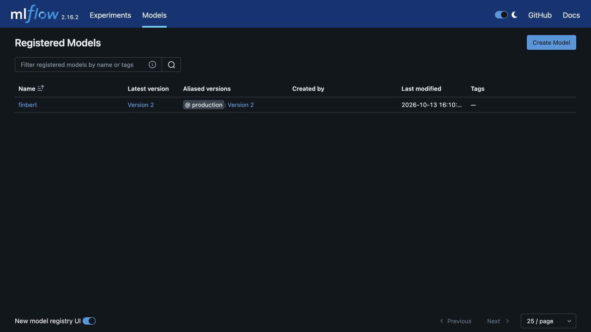
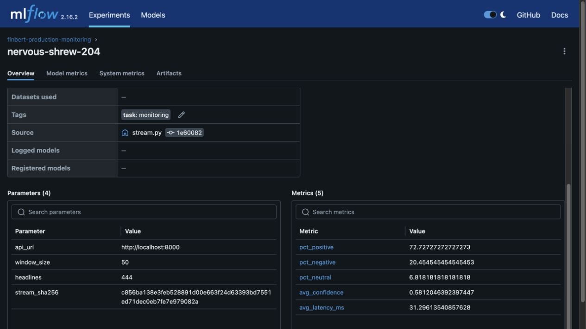

# Final rubric audit

All required criteria were implemented and verified on 13 October 2026.
This is an implementation and evidence audit, not an official Udacity grade.
Optional stand-out suggestions are not counted as required criteria.

Paths below are relative to the repository. Python commands run from starter/.

| Rubric requirement | Implementation | Observed evidence | Status |
| --- | --- | --- | --- |
| DVC stages named prepare and clean | starter/dvc.yaml | Reproduction and forced regeneration passed | Complete |
| Prepare script dependency, split size/seed parameters, train/test outputs | starter/dvc.yaml, scripts/load_data.py | 6,513 train and 1,629 test rows | Complete |
| Clean script and raw-stream dependencies, min/max word parameters, stream output | starter/dvc.yaml, scripts/clean_data.py | 444 cleaned posts from 500 inputs | Complete |
| Commit dvc.lock alongside pipeline | starter/dvc.lock | Checksums preserved on forced reproduction; parameter invalidation verified | Complete |
| MLflow URI, experiment, run, model parameters, four required metrics | starter/scripts/evaluate.py | Actual accuracy 0.63842848, F1 0.59008130, precision 0.61110856, recall 0.63842848 | Complete |
| Register the model under a name | starter/scripts/evaluate.py | finbert version 2 is registered | Complete |
| Read threshold, latest evaluation F1, and promote only when eligible | starter/scripts/promote.py | Threshold 0.56 met; numeric version selection and lineage checks passed | Complete |
| Clear rejection message below threshold | starter/scripts/promote.py | Real CLI rejection preserved the alias; boundary tests passed | Complete |
| Registry UI displays a version and production alias | MLflow registry | Screenshot below shows production: Version 2 | Complete |
| GET /health returns status ok or HTTP 503 | starter/app/main.py | Real API tests and AWS endpoint checks passed | Complete |
| POST /predict schema and HTTP 422/503 behavior | starter/app/main.py | Full text/sentiment/confidence/latency schema and error cases passed | Complete |
| POST /predict/batch schema, matching length, HTTP 422/503 | starter/app/main.py | Ordering, response length, blank/empty validation, and unloaded cases passed | Complete |
| Shared run_prediction helper with timed model inference | starter/app/main.py | Single helper delegates to the timed batch inference path | Complete |
| Three required pytest integration scenarios | starter/tests/test_api.py | Real single, batch, and empty-batch tests passed | Complete |
| Locust tasks with weights 3, 1, 1 and wait_time | starter/scripts/locustfile.py | Four-user, 20-second run completed 71 requests without failures | Complete |
| python:3.12-slim, requirements, app copy, port 8000, CMD | starter/Dockerfile | Linux image build, offline startup, and predictions passed | Complete |
| Compose build, 8000:8000, .env, MLflow mounts, host gateway, health check | starter/docker-compose.yml | Configuration validated; runtime image and monitoring network tested in CI | Complete |
| TextData objects, NLP Sentiment property drift, prediction drift | starter/scripts/run_deepchecks.py | Real scores 0.29129544 and 0.23166959 | Complete |
| Nonzero exit above either configured drift threshold | starter/scripts/run_deepchecks.py | CLI rejection and excessive-score tests passed; thresholds remain 0.5/0.6 | Complete |
| Main-push trigger and lint, test, deepchecks, build, deploy jobs | .github/workflows/ci-cd.yml | Full AWS workflow passed; test and deepchecks depend on lint | Complete |
| Test and quality jobs use MODEL_SOURCE=huggingface | .github/workflows/ci-cd.yml | Linux real-model integration and quality checks passed | Complete |
| Build depends on both gates, authenticates AWS/ECR, pushes SHA/latest | .github/workflows/ci-cd.yml | Exact SHA image was pushed and deployed | Complete |
| Deploy downloads/renders definition and uses ECS deploy action | .github/workflows/ci-cd.yml | Service finbert-api-service in finbert-cluster reached stability | Complete |
| Required ECR, security group, cluster, task family, service | starter/scripts/bootstrap_aws.py | Provisioned and verified in us-east-1; HTTP 80 forwards to API 8000 | Complete |
| Prediction Counter labelled by sentiment, latency-ms Histogram, error Counter | starter/app/main.py | Exposition tests verify counter and histogram increments | Complete |
| Instrument each prediction and count exceptions | starter/app/main.py | Batch increments and controlled error increments passed | Complete |
| GET /metrics uses generate_latest and CONTENT_TYPE_LATEST | starter/app/main.py | Correct exposition response and real scraping passed | Complete |
| JSON log helper includes timestamp, level, message; model/prediction/error calls | starter/app/main.py | Structured log assertions and service logging passed | Complete |
| finbert-api scrape job, 15-second interval, api:8000 | starter/prometheus.yml | Compose target healthy; ECS uses the same configuration with localhost substitution | Complete |
| Monitoring reads stream, opens run, predicts headlines, logs five window metrics by step | starter/monitoring/stream.py | All 444 AWS predictions logged in nine windows at steps 0–8 | Complete |

## Evidence index

- [Task 0 setup](task-0-setup.md)
- [Task 1 DVC](task-1-dvc.md)
- [Task 2 registry](task-2-registry.md)
- [Task 3 API and load test](task-3-api.md)
- [Task 4 containers](task-4-container.md)
- [Task 5 CI/CD](task-5-cicd.md)
- [Task 6 production monitoring](task-6-monitoring.md)
- [Production deployment](evidence/task-6-production-deployment.json)
- [Production Prometheus target and up query](evidence/task-6-production-prometheus.json)
- [Production MLflow windows](evidence/task-6-production-monitoring.json)
- [Successful AWS workflow](https://github.com/marttp/cd15155-ml-ops-starter/actions/runs/38381974733)

The production workflow also retains the monitoring SQLite database as an artifact.
All 33 tests passed. Local registry-backed inference passed all 15 API tests.
Required implementation files contain no unfinished TODO or NotImplementedError.

## Registry UI

## Monitoring UI

This screenshot shows the local verification run. The production evidence above
comes from real AWS traffic and includes the complete nine-window record.

## Reproduction and operating limits

Activate a Python 3.12 project environment before running DVC, evaluation,
promotion, API tests, or monitoring. The dataset and model revisions are pinned.
Generated datasets can be reconstructed with DVC; no remote DVC store is required
by this rubric. The Docker image caches the model and uses CPU inference.

Task 0's loopback MLflow binding is for direct local access. On Linux, a host
MLflow server used by Compose must listen on the host-gateway interface or
0.0.0.0; container localhost is not the host. Compose maps host.docker.internal
to the host gateway and uses port 5001.

The deployment uses one 0.5-vCPU, 2-GiB task and allows replacement downtime.
Its public IP can change after each rollout. Latest endpoint information is in
the latest successful deployment artifact. No NAT gateway or load balancer is
created. The manual service-control workflow can pause or resume this lab service.
Pausing stops compute and the public endpoint; recorded evidence stays available.
The remaining Udacity credit balance has not been measured by this project.

The inherited LICENSE.txt is unchanged. CODEOWNERS remains inherited upstream
review-routing metadata; the fork itself is owned by marttp. Keeping these files
does not establish broader permission to redistribute modified educational content.
